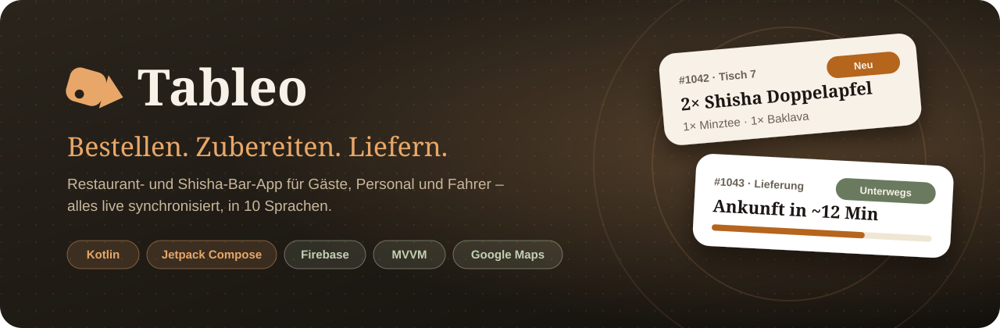
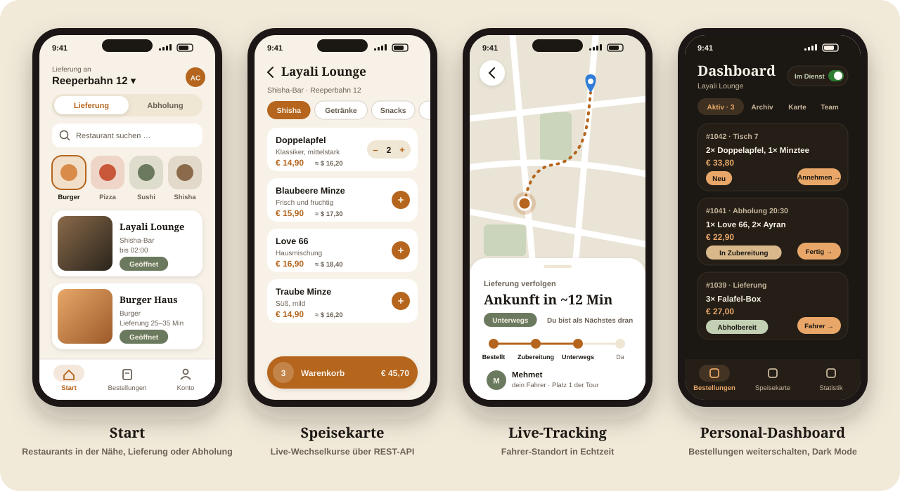
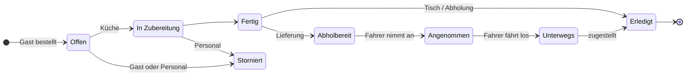
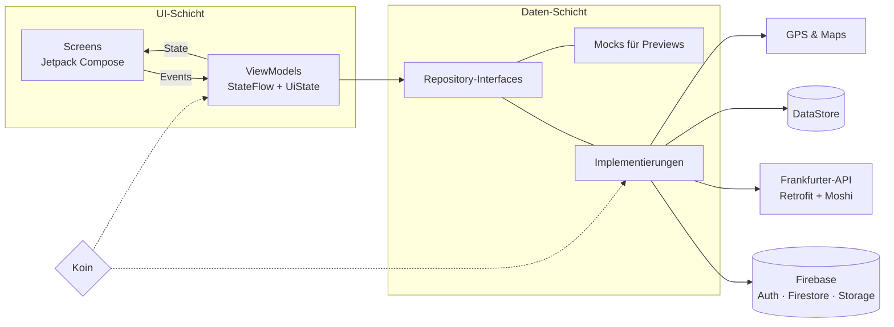

<div align="center">



<br><br>


-3DDC84?style=for-the-badge&logo=android&logoColor=white)

**Eine Bestell-App für Restaurants und Shisha-Bars mit drei Rollen in einer App:**
Gäste bestellen, das Personal bereitet zu, Fahrer liefern aus. Alle Änderungen sind sofort auf allen Geräten zu sehen.

[Funktionen](#funktionen) · [Einblicke](#einblicke) · [Architektur](#architektur) · [Tech-Stack](#tech-stack) · [Einrichtung](#einrichtung)

</div>

<br>

## Highlights

<table>
<tr>
<td width="33%" valign="top">

### ⚡ Live-Status
Jede Bestellung läuft über Firestore-Listener. Schaltet die Küche auf *Fertig*, sieht der Gast es sofort, ohne die Seite neu zu laden.

</td>
<td width="33%" valign="top">

### 🛵 Live-Tracking
Der Fahrer sendet seinen Standort, der Kunde sieht ihn auf Google Maps, dazu die Ankunftszeit und seinen Platz in der Tour.

</td>
<td width="33%" valign="top">

### 🌍 10 Sprachen
Deutsch, Englisch, Türkisch, Arabisch (von rechts nach links), Spanisch, Französisch, Italienisch, Polnisch, Russisch und Ukrainisch.

</td>
</tr>
<tr>
<td valign="top">

### 👥 Drei Rollen
Gast, Personal und Fahrer nutzen dieselbe App. Nach dem Login erkennt Tableo die Rolle und öffnet den passenden Bereich.

</td>
<td valign="top">

### 💱 Wechselkurse
Die Speisekarte zeigt Preise zusätzlich in Fremdwährung, live über die Frankfurter-API (Retrofit + Moshi).

</td>
<td valign="top">

### 🌗 Eigenes Design
Kupfer-und-Espresso-Farben, die Schriften Fraunces und Manrope, Hell- und Dunkelmodus.

</td>
</tr>
</table>

## Einblicke

<div align="center">

<br>
<sub>Design-Vorschau im Stil der App</sub>
</div>

## Funktionen

<details open>
<summary><b>Gäste und Kunden</b></summary>
<br>

| | |
|---|---|
| 🏠 **Startseite** | Lieferadresse und Schalter Lieferung/Abholung, beides bleibt nach dem Neustart gespeichert |
| 🔎 **Entdecken** | Suche, Kategorien mit Bildern und Filter nach Art. Bei Lieferung erscheinen nur Restaurants, die liefern |
| 📖 **Speisekarte** | Kategorien, Preise in Euro und in Fremdwährung |
| 🛒 **Bestellen** | Am Tisch, zur Abholung mit Uhrzeit oder als Lieferung, mit Wahl der Bezahlart |
| 📦 **Meine Bestellungen** | Live-Status, Details, erneut bestellen, stornieren solange die Bestellung noch offen ist |
| 🗺 **Tracking** | Fahrer auf der Karte, Ankunftszeit, Platz in der Tour |
| 🔔 **Benachrichtigungen** | Bei jedem neuen Schritt der Bestellung |
| 👤 **Konto** | Profilbild, Name, E-Mail, Passwort, Konto löschen mit 30 Tagen Frist |

</details>

<details open>
<summary><b>Personal</b></summary>
<br>

| | |
|---|---|
| 🧾 **Dashboard** | Bestellungen weiterschalten (Neu → In Zubereitung → Fertig → Erledigt) oder stornieren |
| 🟢 **Dienst-Schalter** | Wer im Dienst ist, bekommt bei jeder neuen Bestellung eine Nachricht |
| 🍴 **Speisekarte** | Gerichte mit Fotos anlegen, bearbeiten und ausblenden |
| 📊 **Statistik** | Umsatz und Anzahl der Bestellungen als Diagramm, dazu das Archiv |
| 👥 **Team** | Profilbild, Rolle und Dienst-Status. Die Leitung vergibt Rollen und entfernt Mitarbeiter |

</details>

<details open>
<summary><b>Fahrer</b></summary>
<br>

| | |
|---|---|
| 🛵 **Lieferungen** | Aufträge des eigenen Restaurants annehmen |
| 🧭 **Tour** | Reihenfolge sortieren, Route in Google Maps öffnen |
| 📍 **Live-Standort** | Wird während der Fahrt laufend an die Kunden geschickt |

</details>

## Ablauf einer Bestellung



## Architektur

MVVM mit Repository Pattern und Dependency Injection über Koin. Die Screens kennen nur ihr ViewModel, die ViewModels nur Repository-Interfaces. Für Previews gibt es Mock-Repositories.



<details>
<summary><b>Projektstruktur</b></summary>

```
app/src/main/java/com/example/tableo/
├── data/
│   ├── enums/          Status, Rollen, Bezahlarten …
│   ├── model/          Data Classes (Order, MenuItem, Restaurant …)
│   ├── remote/         Wechselkurs-API und Firestore-Collection-Namen
│   └── repository/     Interfaces, impl/ (Firebase, DataStore, Retrofit, GPS), mock/ (Previews)
├── di/                 Koin-Module
├── navigation/         Typisierte Routen
├── ui/
│   ├── components/     Wiederverwendbare Bausteine
│   ├── guest/          Restaurantliste, Speisekarte, Warenkorb, Lieferung
│   ├── customer/       Login, Konto, Bestellungen, Tracking
│   ├── staff/          Dashboard, Speisekarte, Archiv, Statistik, Team
│   ├── driver/         Lieferungen und Tour
│   ├── settings/ legal/ onboarding/ splash/
│   └── theme/          Farben, Schriften, Abstände
└── util/               Formatieren, Berechtigungen, Sprache, Öffnungszeiten
```

- Screens, ViewModels, UiStates, Models und Enums stehen jeweils in einer eigenen Datei
- Jedes Composable hat eine Preview
- Fehler kommen als `UiState.Error` mit verständlicher Meldung in der eingestellten Sprache

</details>

## Tech-Stack

| Bereich | Technik |
|---|---|
| Sprache | Kotlin, Coroutines und Flow |
| Oberfläche | Jetpack Compose, Material 3, eigene Theme-Palette |
| Architektur | MVVM, Repository Pattern, Unidirectional Data Flow |
| Dependency Injection | Koin |
| Navigation | Navigation Compose mit typisierten Routen (kotlinx.serialization) |
| Backend | Firebase Authentication (E-Mail und anonym), Cloud Firestore, Cloud Storage |
| API | Retrofit + Moshi ([Frankfurter](https://www.frankfurter.app/)) |
| Bilder | Coil 3 |
| Lokal speichern | DataStore Preferences |
| Karte & Standort | Google Maps Compose, FusedLocationProvider, Geocoder |
| System | Benachrichtigungen, Laufzeit-Berechtigungen, Photo Picker |

## Einrichtung

```bash
git clone https://github.com/Ali-C313/Tableo-Android.git
```

1. Projekt in **Android Studio** öffnen und Gradle Sync ausführen
2. In der Firebase Console die `google-services.json` herunterladen und nach `app/` legen (sie ist nicht im Repo)
3. Für die Karte in `local.properties` eintragen:
   ```properties
   MAPS_API_KEY=dein-key
   ```
4. In der Firebase Console unter **Authentication → Sign-in method** den Anbieter **Anonym** aktivieren
5. Run-Konfiguration `app` starten

<details>
<summary><b>Mitarbeiter und Fahrer anlegen</b></summary>
<br>

- Mitarbeiter und Fahrer registrieren sich wie Kunden, schalten dabei *„Ich arbeite in einem Restaurant“* ein, wählen *„Im Team“* oder *„Als Fahrer“* und tragen die Restaurant-ID ein (Firestore-Dokument-ID, z.B. `layali-lounge`)
- Die ID steht im Dashboard unter **Team**, dort sind auch alle Mitarbeiter zu sehen
- Rollen: Leitung, Kellner, Koch, Küchenhilfe, Bar, Lieferant. Die erste Leitung wird in der Firebase Console gesetzt
- Beim Login erkennt die App über `staffProfiles`, ob das Konto zu einem Restaurant gehört, und öffnet direkt das Dashboard bzw. den Fahrer-Bereich
- Restaurants ohne Lieferung bekommen in Firestore `offersDelivery = false` und erscheinen dann nur bei *Abholung*

</details>

<details>
<summary><b>Firestore-Regeln</b></summary>
<br>

Team-Einträge in `staffProfiles` haben die User-ID als Dokument-ID. So prüfen die Regeln direkt, wo jemand arbeitet und ob er die Leitung hat.

```
rules_version = '2';
service cloud.firestore {
  match /databases/{database}/documents {

    function signedIn() {
      return request.auth != null;
    }

    function hasProfile() {
      return signedIn()
        && exists(/databases/$(database)/documents/staffProfiles/$(request.auth.uid));
    }

    function myProfile() {
      return get(/databases/$(database)/documents/staffProfiles/$(request.auth.uid)).data;
    }

    function worksAt(restaurantId) {
      return hasProfile() && myProfile().restaurantId == restaurantId;
    }

    function leads(restaurantId) {
      return worksAt(restaurantId) && myProfile().role == 'LEITUNG';
    }

    match /restaurants/{restaurantId} {
      allow read: if true;
      allow write: if false;
    }

    match /menuItems/{menuItemId} {
      allow read: if true;
      allow create: if worksAt(request.resource.data.restaurantId);
      allow update, delete: if worksAt(resource.data.restaurantId);
    }

    match /orders/{orderId} {
      allow read: if signedIn();
      allow create: if signedIn() && request.resource.data.status == 'OFFEN';
      // Personal und Fahrer des Restaurants, oder der Kunde selbst (Stornieren)
      allow update: if worksAt(resource.data.restaurantId)
        || (signedIn() && resource.data.userId == request.auth.uid);
      allow delete: if false;
    }

    // Zusatzdaten zum Konto, z.B. Lösch-Vormerkung
    match /users/{userId} {
      allow read, write: if signedIn() && request.auth.uid == userId;
    }

    match /staffProfiles/{profileId} {
      allow read: if signedIn();
      // eigenes Profil anlegen, aber nicht selbst zur Leitung machen
      allow create: if (signedIn()
          && profileId == request.auth.uid
          && request.resource.data.userId == request.auth.uid
          && request.resource.data.role in ['OHNE', 'LIEFERANT'])
        || leads(request.resource.data.restaurantId);
      // eigenes Profil: Dienst, Bild und Name ja, Rolle und Restaurant nur durch die Leitung
      allow update: if (signedIn()
          && profileId == request.auth.uid
          && request.resource.data.role == resource.data.role
          && request.resource.data.restaurantId == resource.data.restaurantId)
        || leads(resource.data.restaurantId);
      allow delete: if (signedIn() && profileId == request.auth.uid)
        || leads(resource.data.restaurantId);
    }
  }
}
```

</details>

<details>
<summary><b>Storage-Regeln</b></summary>
<br>

Für Speisekarten-Fotos und Profilbilder, Firebase Storage braucht den Blaze-Tarif.

```
rules_version = '2';
service firebase.storage {
  match /b/{bucket}/o {
    match /menuItems/{restaurantId}/{fileName} {
      allow read, write: if true;
    }
    match /profilePhotos/{fileName} {
      allow read, write: if true;
    }
  }
}
```

</details>

<details>
<summary><b>Konto löschen mit 30 Tagen Frist</b></summary>
<br>

- Unter **Konto → Konto löschen** mit dem Passwort bestätigen
- Das Konto wird nur vorgemerkt (`users/{userId}.deletionRequestedAt`) und abgemeldet
- Wer sich innerhalb von 30 Tagen wieder anmeldet, behält sein Konto
- Danach wird es beim nächsten Anmeldeversuch endgültig gelöscht: Firebase-Konto, Team-Eintrag und Profilbild. Bestellungen bleiben beim Restaurant
- Ganz automatisch, auch ohne erneuten Login, geht es mit einer Cloud Function (Blaze-Tarif):

```js
const { onSchedule } = require("firebase-functions/v2/scheduler");
const admin = require("firebase-admin");
admin.initializeApp();

// läuft jede Nacht und löscht Konten, deren Vormerkung älter als 30 Tage ist
exports.deleteExpiredAccounts = onSchedule("every day 03:00", async () => {
  const limit = Date.now() - 30 * 24 * 60 * 60 * 1000;
  const db = admin.firestore();
  const expired = await db.collection("users").where("deletionRequestedAt", "<", limit).get();

  for (const doc of expired.docs) {
    const uid = doc.id;
    if (doc.data().deletionRequestedAt <= 0) continue;
    await db.collection("staffProfiles").doc(uid).delete().catch(() => {});
    await admin.storage().bucket().file(`profilePhotos/${uid}.jpg`).delete().catch(() => {});
    await admin.auth().deleteUser(uid).catch(() => {});
    await doc.ref.delete();
  }
});
```

</details>

## Sprachen

| 🇩🇪 Deutsch | 🇬🇧 English | 🇹🇷 Türkçe | 🇸🇦 العربية | 🇪🇸 Español |
|:---:|:---:|:---:|:---:|:---:|
| **🇫🇷 Français** | **🇮🇹 Italiano** | **🇵🇱 Polski** | **🇷🇺 Русский** | **🇺🇦 Українська** |

Auswahl unter **Konto → Einstellungen → Sprache**, *„Wie am Handy“* übernimmt die Sprache des Geräts. Die Texte liegen in `app/src/main/res/values*/strings_*.xml`, eine Datei pro Bereich.

## Ausblick

- [ ] Push-Nachrichten auch bei geschlossener App (Firebase Cloud Messaging + Cloud Functions)
- [ ] Fahrer-Standort auch im Hintergrund senden (Foreground Service)
- [ ] Ankunftszeit über eine echte Route statt Luftlinie
- [ ] Bezahlung direkt in der App
- [ ] Unit-Tests für ViewModels und Repositories

## Autor

<div align="center">

**Ali** · Abschlussprojekt B29 · [Syntax Institut](https://syntax-institut.de)

[](https://github.com/Ali-C313)

</div>
